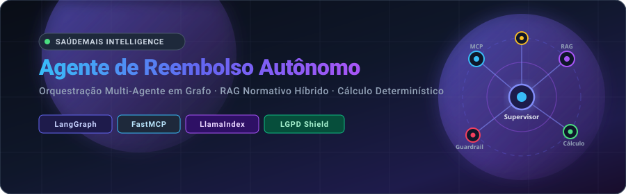
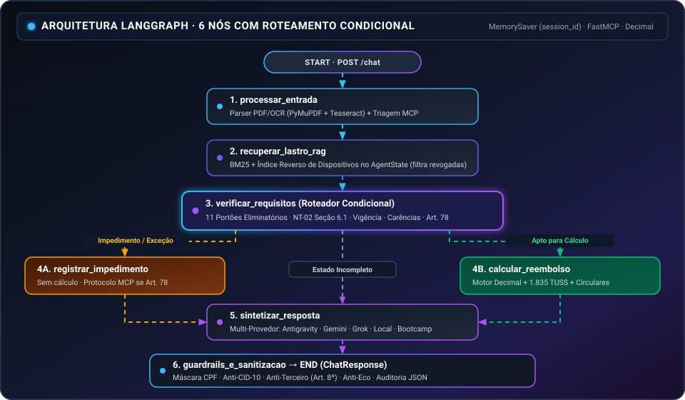
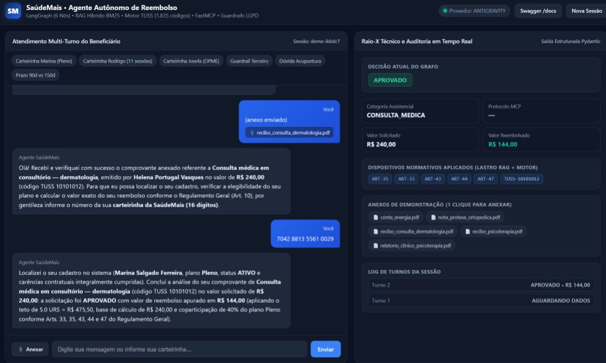

<div align="center">



<br/>

[-64748B?style=for-the-badge)](README.md)
[](#)

<br/>

[](https://python.org)
[](https://github.com/langchain-ai/langgraph)
[](https://llamaindex.ai)
[](https://modelcontextprotocol.io)
[](https://fastapi.tiangolo.com)
[](https://www.docker.com)
[](https://github.com/lucenfort/agente-reembolso/actions/workflows/tests.yml)
[](LICENSE)

</div>

---

## Overview

Implementation of the **Autonomous Reimbursement Agent** for **SaúdeMais Supplementary Healthcare**, originally developed for the **Bootcamp AI Engineer 2026 Technical Challenge (Exam 339EF4)** and evolved with a verifiable 6-node architecture, multi-provider LLM support, and a real-time audit web interface.

The system operates as an autonomous regulatory and customer service analyst, featuring:
1. Conducting multi-turn empathetic and contextual natural language dialogues with health plan beneficiaries (including out-of-order messages and attachments);
2. Parsing, classifying, and extracting metadata from medical receipts and clinical reports in **native PDF and scanned images via OCR**;
3. Interfacing via the **Model Context Protocol (MCP)** to verify eligibility, query annual treatment history, and register official service protocols;
4. Retrieving complex regulatory devices (General Bylaws, Technical Note 02, Annex IV, 2026 URS Table, and Circulars) via **hybrid retrieval (BM25 + reverse device index + LlamaIndex)** with evidence grounded in `AgentState`;
5. Executing deterministic calculations with centesimal precision (`Decimal`), enforcing **12 eliminatory verification gates** and consulting **1,835 TUSS codes** before any financial calculation;
6. Enforcing strict **LGPD privacy and medical secrecy guardrails** (mandatory CPF masking, suppression of ICD-10 diagnostic codes, and refusal of third-party data queries without terminating the active session);
7. Exposing an **Interactive Web UI (`GET /`)** with a real-time **Technical X-Ray** panel to inspect graph decisions, calculations, MCP protocols, and applied regulatory devices.

### Original Challenge Summary
The technical challenge simulated real customer support for a supplementary health insurer (**SaúdeMais**) governed by dense regulatory rules, requiring:
- **Out-of-order conversations:** handling attachments sent before the membership card, or missing documents arriving in later turns without losing the active workflow;
- **Temporal validity and norm hierarchy:** applying rules by event date (`Circular 11/2026` vs. `Circular 02/2026`), filtering out revoked norms (`Circular 04/2025` revoked by `09/2025`), and cross-checking legacy MCP data (such as annual therapy session counts);
- **Approval limits and OPME:** escalating special materials and high-value claims (Art. 78) by opening an MCP protocol while strictly prohibiting prior value estimates;
- **Privacy and LGPD:** preventing full CPF leaks, ICD-10 exposure, and third-party queries within the same session.

### Improvements Implemented Beyond the Challenge (and Why)

| Improvement Implemented | Why It Was Built |
| :--- | :--- |
| **6-Node LangGraph with Conditional Routing** | Ensures `calcular_reembolso` is only reachable after passing all **11 eliminatory gates** (`verificar_requisitos`), preventing premature approvals or invalid estimates. |
| **Unified MCP History Reader (`/beneficiario` + `/historico`)** | Guarantees consistent `sessoes_terapia_ano` tracking regardless of which MCP endpoint provides the counter, enforcing clinical report requirements (Art. 73). |
| **Deterministic `Decimal` Engine + 1,835 TUSS Codes + Temporal Rules** | Eliminates LLM arithmetic drift in financial calculations, covers all TUSS groups (including description-based inference), and enforces date-based circulars (`11/2026` vs. `02/2026`), waiting periods (`15d/60d/150d/180d/0d`), and medical orders (Art. 38). |
| **Offline Hybrid RAG (`BM25` + Reverse Device Index)** | Removes exclusive reliance on external embedding gateways, persists `evidencias_rag` in `AgentState`, and filters revoked norms. |
| **Multi-Provider LLM Layer with Automatic Fallback** | Supports switching dynamically across `bootcamp`, `gemini`, `grok`, `local` (Ollama/LM Studio/vLLM), and offline `antigravity`, preventing external API downtime. |
| **Interactive Web UI + 17-Test `pytest` Suite + CI** | Provides a real-time visual **Technical X-Ray** panel for inspection of decisions, MCP protocols, and regulatory grounding, backed by automated GitHub Actions CI. |

---

## Table of Contents

1. [System Architecture](#system-architecture)
2. [Repository Structure](#repository-structure)
3. [Supported AI Providers](#supported-ai-providers-llm_provider)
4. [Prerequisites and Setup](#prerequisites-and-setup)
5. [Running the MCP Server](#running-the-mcp-server)
6. [Running the FastAPI Agent and Web UI](#running-the-fastapi-agent-and-web-ui)
7. [Ingestion and RAG Index Build](#ingestion-and-rag-index-build)
8. [Running the Evaluation Test Suite](#running-the-evaluation-test-suite)
9. [Docker Build and Execution](#docker-build-and-execution)
10. [Scenario Coverage and Validation](#scenario-coverage-and-validation)

---

## System Architecture

The architecture follows a **6-Node Graph-Oriented Multi-Agent Supervisor Pattern with Conditional Routing**, ensuring complete separation between verification, conversational reasoning, and deterministic financial calculation:

<div align="center">
  
</div>

### Core Modules
* **6-Node LangGraph Supervisor (`app/agents/supervisor/`):** State graph with `MemorySaver` checkpointer keyed by `session_id` and strict conditional routing before calculation.
* **Triage & Eligibility Subagent (`app/agents/triagem/`):** 16-digit card validation (separating titular vs. third-party cards in the same message) and FastMCP integration with resilient local fallback.
* **Document & OCR Subagent (`app/agents/documento/`):** Structured invoice metadata extraction via PyMuPDF/pypdf and Tesseract OCR from Base64 payloads, validating NT-02 fields and Annex IV exclusions.
* **Normative RAG Subagent (`app/rag/`):** Hybrid retrieval (**BM25 Okapi + reverse device index + LlamaIndex**) storing `evidencias_rag` in `AgentState` and filtering out revoked norms (`CIRC-04-2025`).
* **12-Gate Deterministic Engine (`app/calculo/`):** Python pipeline with `Decimal` precision integrated with **1,835 TUSS codes** from `storage/tuss_tabela.json`, temporal circular rules (`Circular 11/2026` vs. `Circular 02/2026`), continued therapy cap (`2.6 URS`), and exact waiting periods.
* **Multi-Provider LLM Layer (`app/llm.py` & `avaliacao/llm.py`):** Native support for `bootcamp`, `gemini`, `grok`, `local` (Ollama/LM Studio/vLLM), and `antigravity`.
* **Guardrails Sanitizer (`app/guardrails/`):** Dual-layer protection for CPF anonymization, ICD-10 suppression, anti-echo, and third-party request blocking (Art. 8).

---

## Repository Structure

```text
agente-reembolso/
├── app/                  # FastAPI application core and agent logic
│   ├── agents/           # Specialized subagents (triage, document, norms, supervisor + synthesizer)
│   ├── calculo/          # 12-gate deterministic calculation engine and TUSS lookup
│   ├── guardrails/       # LGPD, CPF, anti-echo, and medical privacy filters
│   ├── rag/              # Hybrid BM25 + LlamaIndex retrieval engine
│   ├── static/           # Interactive Web UI (Chat + Real-time Audit Panel)
│   ├── tools/            # MCP client with resilient local fallback
│   ├── llm.py            # Multi-provider LLM layer (Bootcamp, Gemini, Grok, Local, Antigravity)
│   ├── main.py           # HTTP Server (/, /docs, /health, /chat, /reset)
│   └── schemas.py        # Pydantic v2 request and response schemas
├── assets/               # Public visual assets (animated SVG banner)
├── avaliacao/            # Official evaluation engine (Multi-provider LLM Judge)
├── anexos/               # Sample attachment files for local testing
├── casos_treino/         # Structured training scenarios (01, 02, and 03 with ground truth)
├── ingest/               # Ingestion and offline indexing scripts
├── kb/                   # Official regulatory knowledge base
├── mcp/                  # Healthcare operator FastMCP server
├── storage/              # Persisted vector index, docstore, and 1,835-entry TUSS dictionary
├── tests/                # Automated pytest suite (17 tests)
├── docker-compose.yml    # Local development orchestration
├── Dockerfile            # Optimized production container image
├── requirements.txt      # Pinned dependencies (Python 3.11)
├── rodar_treino.py       # Training case evaluation CLI
├── README.md             # Portuguese Documentation (Default)
└── README.en.md          # English Documentation
```

---

## Supported AI Providers (`LLM_PROVIDER`)

The system supports **5 execution modes** configurable via `.env` (see [`.env.example`](.env.example)):
- **`antigravity`:** Deterministic local normative synthesizer (100% offline, zero API cost).
- **`gemini`:** Google Gemini API (`GEMINI_API_KEY`, default `gemini-2.5-flash`).
- **`grok`:** xAI Grok API (`GROK_API_KEY`, default `grok-3-mini`).
- **`local`:** OpenAI-compatible Local AI or Ollama (`LOCAL_LLM_URL`, e.g. `http://localhost:11434/v1`).
- **`bootcamp` / `auto`:** Official exam gateway (`BOOTCAMP_LLM_ENDPOINT` + `BOOTCAMP_API_KEY`).

---

## Prerequisites and Setup

Requires **Python 3.11** and **Docker** (optional for local runs).

1. **Clone the repository and set up the virtual environment:**
   ```bash
   python3.11 -m venv .venv
   source .venv/bin/activate
   pip install -r requirements.txt
   ```

2. **Configure environment variables:**
   Copy `.env.example` to `.env` and fill in the credentials provided:
   ```bash
   cp .env.example .env
   ```

3. **Verify LLM gateway connectivity:**
   ```bash
   python -m app.llm
   ```

---

## Running the MCP Server

The FastMCP server simulates the legacy operator backend on port 9000.

### Option 1: Local Python
```bash
PYTHONPATH=mcp MCP_OPERADORA_DADOS=casos_treino MCP_OPERADORA_TOKEN=treino python -m mcp_operadora.server
```

### Option 2: Docker Compose
```bash
docker compose up -d mcp
```

To verify MCP server health:
```bash
curl -s -o /dev/null -w "%{http_code}\n" http://localhost:9000/mcp
# Expected output: 401 (active service requiring authorization token)
```

---

## Running the FastAPI Agent and Web UI

With your virtual environment activated, launch the FastAPI server on port `8000`:

```bash
uvicorn app.main:app --host 0.0.0.0 --port 8000 --reload
```

### Available Endpoints and Web UI:
* `GET  /`       — **Interactive Web UI** (Multi-turn Chat + File Upload + Real-Time Audit Panel);
* `GET  /docs`   — Interactive Swagger / OpenAPI docs;
* `GET  /health` — Readiness probe (`status: "ok"`);
* `POST /chat`   — Multi-turn message and Base64 attachment processing;
* `POST /reset`  — State reset for specific or global sessions.

<div align="center">
  
</div>

---

## Ingestion and RAG Index Build

The vector index is **pre-built and bundled** in `storage/`. To rebuild the database from `kb/`:

```bash
python ingest/build.py
```

---

## Running the Evaluation Test Suite

### 1. Automated Suite (`pytest` — 17 tests)
```bash
pytest -v
```

### 2. Official Training Runner against Live Servers

With both the MCP server (port 9000) and the agent (port 8000) running:

```bash
# Standard deterministic mode (fixed script with ground truth validation)
python rodar_treino.py --roteiro-fixo

# Verbose dynamic mode with simulated LLM beneficiary
python rodar_treino.py -v

# Run a specific test case
python rodar_treino.py --caso 01
```

---

## Docker Build and Execution

To validate the container package in a clean environment:

```bash
# Build the container image (~1.5 min build time)
docker build -t reembolso .

# Run the container with environment variables
docker run -d --env-file .env -p 8000:8000 reembolso
```

---

## Scenario Coverage and Validation

All core flows and regulatory rules are automatically validated by the `pytest` suite (`17` passing tests) and `rodar_treino.py`:

| Validation Scenario | Regulatory Challenge / Edge Case | Validated Turns | Outcome |
| :--- | :--- | :---: | :---: |
| **Case 01 (Dermatology)** | Attachment before context, third-party refusal (Art. 8), 40\% copay | 8 / 8 | `APROVADO` |
| **Case 02 (Psychotherapy)** | 12th session in MCP history, mandatory clinical report (Art. 73), annual cap | 9 / 9 | `APROVADO` |
| **Case 03 (OPME Prosthesis)** | Invalid attachment (utility bill), re-upload, human expert audit (Art. 78) | 7 / 7 | `ESCALADO_ANALISTA` |
| **Extended Rules (`pytest`)** | Temporal circular rules, 1,835 TUSS, waiting periods, 90d limit, Art. 38, RAG & API | 14 suites | **17 / 17 PASS** |

---

<div align="center">
  <sub>Developed for the Bootcamp AI Engineer 2026 (Exam 339EF4).</sub>
</div>
