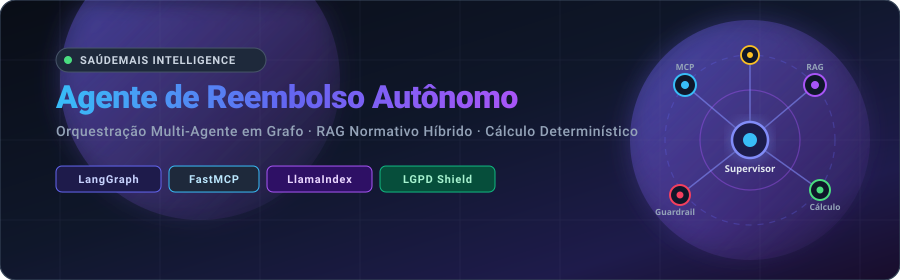
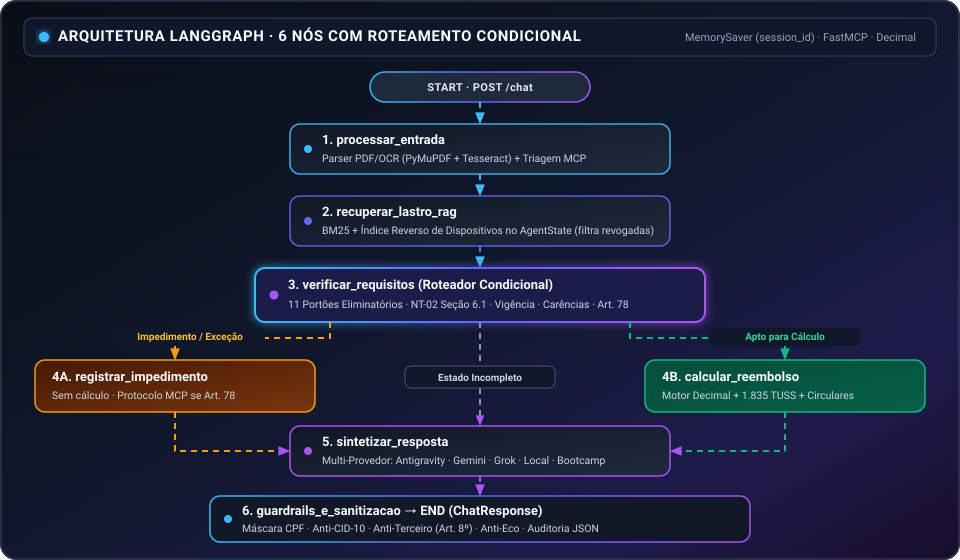

<div align="center">



<br/>

[-0F2C59?style=for-the-badge)](#)
[](README.en.md)

<br/>

[](https://python.org)
[](https://github.com/langchain-ai/langgraph)
[](https://llamaindex.ai)
[](https://modelcontextprotocol.io)
[](https://fastapi.tiangolo.com)
[](https://www.docker.com)

</div>

---

## Visão Geral

Implementação do **Agente Autônomo de Reembolso** para a **SaúdeMais Saúde Suplementar**, desenvolvido como solução para o desafio técnico do **Bootcamp AI Engineer 2026 (Prova 339EF4)** e evoluído com arquitetura verificável, suporte multi-provedor e interface web de auditoria em tempo real.

### O que o projeto faz
O sistema atua como um analista regulatório e de atendimento ao cliente em Saúde Suplementar, sendo capaz de:
1. Conduzir diálogos acolhedores, didáticos e empáticos em linguagem natural (*atendimento multi-turno*, inclusive com mensagens e anexos fora de ordem);
2. Processar, classificar e extrair dados de documentos fiscais e laudos clínicos em **PDF nativo e imagens escaneadas via OCR**;
3. Integrar-se via **Model Context Protocol (MCP)** para consultar dados cadastrais, histórico anual de sessões e emitir protocolos oficiais na operadora;
4. Recuperar normativas complexas da SaúdeMais (Regulamento Geral, Nota Técnica 02, Anexo IV, Tabela URS 2026 e Circulares) por **busca híbrida (BM25 + índice reverso de dispositivos + LlamaIndex)** com lastro registrado no estado;
5. Calcular deterministamente valores devidos com precisão decimal exata (`Decimal`), aplicando **12 portões eliminatórios** antes de qualquer cálculo financeiro e consultando os **1.835 códigos TUSS**;
6. Assegurar conformidade rigorosa com a **LGPD e regras de sigilo** (mascaramento de CPF, supressão de diagnósticos/CID-10 e recusa de consulta a dados de terceiros sem encerrar a sessão em curso);
7. Expor uma **Interface Web Interativa (`GET /`)** com painel **Raio-X Técnico** em tempo real para inspeção de decisões, cálculos, protocolos MCP e dispositivos aplicados.

### Resumo do Desafio Original
O desafio propunha construir um agente autônomo para uma operadora fictícia (**SaúdeMais**) capaz de conduzir atendimentos multi-turno de reembolso médico com regras regulatórias densas, envolvendo:
- **Conversas fora de ordem:** receber anexos antes da carteirinha ou receber documentos faltantes em turnos posteriores sem perder o protocolo aberto;
- **Vigência temporal e hierarquia de normas:** distinguir regras por data do evento (`Circular 11/2026` vs. `Circular 02/2026`), ignorar normas revogadas (`Circular 04/2025` revogada pela `09/2025`) e cruzar dados do sistema legado via MCP (como a contagem real de sessões de terapia no ano);
- **Alçada e OPME:** escalar materiais especiais e valores acima da alçada (Art. 78) abrindo protocolo MCP, com proibição estrita de estimar valor prévio ao beneficiário;
- **Sigilo e LGPD:** impedir vazamento de CPF completo, CID-10 e informações de terceiros na mesma sessão.

### Melhorias Implementadas Além do Desafio (e Por Quê)

Para transformar o protótipo inicial em uma arquitetura auditável, resiliente e pronta para demonstração e produção, foram implementadas as seguintes evoluções:

| Melhoria Implementada | Por que foi desenvolvida |
| :--- | :--- |
| **Grafo LangGraph de 6 Nós com Roteamento Condicional** | Garante que o nó `calcular_reembolso` só seja alcançável após aprovação nos **11 portões eliminatórios** (`verificar_requisitos`), impedindo aprovações ou estimativas indevidas antes da validação completa. |
| **Leitura Unificada de Histórico MCP (`/beneficiario` + `/historico`)** | Assegura consistência na contagem de `sessoes_terapia_ano` independentemente do endpoint retornado pelo servidor MCP, garantindo a exigência correta do relatório clínico (Art. 73). |
| **Motor Determinístico `Decimal` + 1.835 Códigos TUSS + Vigência Temporal** | Elimina imprecisões numéricas de LLM em cálculos financeiros, cobre todos os grupos TUSS (com inferência por descrição) e aplica automaticamente as regras vigentes por data (`Circular 11/2026` vs. `02/2026`), carências (15d/60d/150d/180d/0d) e pedido médico (Art. 38). |
| **RAG Híbrido Offline (`BM25` + Índice Reverso de Dispositivos)** | Remove a dependência exclusiva de gateway externo para busca normativa, grava `evidencias_rag` diretamente no `AgentState` e filtra normas revogadas. |
| **Suporte Multi-Provedor com Fallback Automático** | Permite alternar dinamicamente entre `bootcamp`, `gemini`, `grok`, `local` (Ollama/LM Studio/vLLM) e `antigravity` offline, evitando indisponibilidade em chamadas externas. |
| **Interface Web Interativa + Suíte de 17 Testes (`pytest`) + CI** | Entrega um painel visual (**Raio-X Técnico**) para inspeção em tempo real de decisões, protocolos MCP e lastro normativo, além de cobertura automatizada via GitHub Actions. |

---

## Sumário

1. [Arquitetura do Sistema](#arquitetura-do-sistema)
2. [Estrutura do Repositório](#estrutura-do-repositório)
3. [Provedores de IA Suportados](#provedores-de-ia-suportados-llm_provider)
4. [Pré-requisitos e Instalação](#pré-requisitos-e-instalação)
5. [Execução do Servidor MCP](#execução-do-servidor-mcp)
6. [Execução do Agente FastAPI e Interface Web](#execução-do-agente-fastapi-e-interface-web)
7. [Ingestão e Construção do Índice Normativo (RAG)](#ingestão-e-construção-do-índice-normativo-rag)
8. [Execução dos Testes de Avaliação](#execução-dos-testes-de-avaliação)
9. [Build e Execução via Docker](#build-e-execução-via-docker)
10. [Cobertura de Cenários e Validação](#cobertura-de-cenários-e-validação)

---

## Arquitetura do Sistema

A solução adota o padrão **Supervisor Multi-Agente Orientado a Grafo (6 Nós com Roteamento Condicional)**, garantindo segregação estrita entre raciocínio conversacional, verificação eliminatória e cálculo financeiro determinístico:

<div align="center">
  
</div>

### Componentes Principais
* **Supervisor LangGraph de 6 Nós (`app/agents/supervisor/`):** Grafo de estados com checkpointer `MemorySaver` indexado por `session_id` e roteamento condicional estrito (`processar_entrada` $\rightarrow$ `recuperar_lastro_rag` $\rightarrow$ `verificar_requisitos` $\rightarrow$ `registrar_impedimento` | `calcular_reembolso` $\rightarrow$ `sintetizar_resposta` $\rightarrow$ `guardrails_e_sanitizacao`).
* **Subagente de Triagem e Elegibilidade (`app/agents/triagem/`):** Validação de carteirinhas de 16 dígitos (separando titular e terceiros mesmo na mesma mensagem) e integração FastMCP (`consultar_beneficiario`, `consultar_historico`, `abrir_protocolo`) com fallback local resiliente.
* **Subagente de Documentos & OCR (`app/agents/documento/`):** Extração de metadados fiscais via PyMuPDF/pypdf e Tesseract OCR a partir de payloads Base64, validando os campos obrigatórios C1 a C7 da NT-02 e os 10 grupos do Anexo IV.
* **Subagente de RAG Normativo (`app/rag/`):** Recuperador híbrido (**BM25 Okapi + Índice Reverso de Dispositivos + LlamaIndex**) com registro obrigatório de `evidencias_rag` no `AgentState` e filtro contra normas revogadas (`CIRC-04-2025`).
* **Motor Determinístico de 12 Portões (`app/calculo/`):** Pipeline em Python com precisão `Decimal`, integrado aos **1.835 códigos TUSS** de `storage/tuss_tabela.json` (incluindo inferência por descrição conforme Art. 34 § 2º), aplicando a Tabela URS 2026 (R$ 95,10), vigência temporal (`Circular 11/2026` vs `Circular 02/2026`), teto reduzido de psicoterapia continuada ($\ge 8ª$ sessão = 2,6 URS) e carências contratuais (15d, 60d, 150d, 180d e 0d em urgência).
* **Camada Multi-Provedor de LLM (`app/llm.py` e `avaliacao/llm.py`):** Suporte nativo a **5 provedores** configuráveis via `LLM_PROVIDER`: Gateway Oficial (`bootcamp`), Google Gemini API (`gemini`), xAI Grok API (`grok`), IA Local via Ollama/LM Studio/vLLM (`local`) e Modo Agente Local (`antigravity`).
* **Guardrails Sanitizer (`app/guardrails/`):** Camada de proteção para anonimização de CPF, neutralização de termos de CID-10, bloqueio de consultas a terceiros (Art. 8º) e proteção anti-eco.

---

## Estrutura do Repositório

```text
agente-reembolso/
├── app/                  # Núcleo da aplicação FastAPI e lógica dos agentes
│   ├── agents/           # Subagentes especializados (triagem, documento, normas, supervisor + synthesizer)
│   ├── calculo/          # Motor determinístico de 12 portões, vigência temporal e tabela TUSS
│   ├── guardrails/       # Validadores e filtros de LGPD, CPF, anti-eco e sigilo médico
│   ├── rag/              # Mecanismo de busca híbrida (BM25 + LlamaIndex) e índice de dispositivos
│   ├── tools/            # Clientes MCP com fallback local resiliente
│   ├── llm.py            # Camada multi-provedor (Bootcamp, Gemini, Grok, IA Local e Antigravity)
│   ├── main.py           # Servidor HTTP (/health, /chat, /reset)
│   └── schemas.py        # Modelos Pydantic v2 de requisição e resposta
├── assets/               # Ativos visuais públicos (banner SVG animado)
├── avaliacao/            # Motor de avaliação oficial da prova (Juiz LLM multi-provedor)
├── anexos/               # Arquivos anexos de exemplo para testes locais
├── casos_treino/         # Casos de teste estruturados (01, 02 e 03 com gabaritos)
├── ingest/               # Scripts de ingestão e indexação offline
├── kb/                   # Base de conhecimento regulatória oficial
├── mcp/                  # Servidor FastMCP da operadora de saúde
├── storage/              # Índice vetorial, docstore e tabela TUSS (1.835 códigos)
├── tests/                # Suíte automatizada de testes ponta a ponta e regras normativas (pytest)
├── docker-compose.yml    # Orquestração local de desenvolvimento
├── Dockerfile            # Imagem de produção otimizada
├── requirements.txt      # Dependências fixadas
├── rodar_treino.py       # CLI de execução dos casos de treino
├── README.md             # Documentação principal em Português
└── README.en.md          # Documentação completa em Inglês
```

---

## Provedores de IA Suportados (`LLM_PROVIDER`)

O sistema suporta **5 modos de execução** configuráveis via `.env` (veja [`.env.example`](.env.example)):
- **`antigravity`:** Sintetizador normativo local determinístico (100% offline, sem chave de API externa).
- **`gemini`:** Google Gemini API (`GEMINI_API_KEY`, padrão `gemini-2.5-flash`).
- **`grok`:** xAI Grok API (`GROK_API_KEY`, padrão `grok-3-mini`).
- **`local`:** IA Local compatível com OpenAI ou Ollama (`LOCAL_LLM_URL`, ex.: `http://localhost:11434/v1`).
- **`bootcamp` / `auto`:** Gateway oficial da banca (`BOOTCAMP_LLM_ENDPOINT` + `BOOTCAMP_API_KEY`).

---

## Pré-requisitos e Instalação

Requer **Python 3.11** e **Docker** (opcional para execução local).

1. **Clonar o repositório e criar o ambiente virtual:**
   ```bash
   python3.11 -m venv .venv
   source .venv/bin/activate
   pip install -r requirements.txt
   ```

2. **Configurar as variáveis de ambiente:**
   Copie o arquivo `.env.example` para `.env` e preencha as credenciais fornecidas:
   ```bash
   cp .env.example .env
   ```

3. **Validar a conectividade com o gateway LLM:**
   ```bash
   python -m app.llm
   ```

---

## Execução do Servidor MCP

O servidor FastMCP simula o sistema legado da operadora e roda na porta 9000.

### Opção 1: Python Local
```bash
PYTHONPATH=mcp MCP_OPERADORA_DADOS=casos_treino MCP_OPERADORA_TOKEN=treino python -m mcp_operadora.server
```

### Opção 2: Docker Compose
```bash
docker compose up -d mcp
```

Para verificar o status do servidor MCP:
```bash
curl -s -o /dev/null -w "%{http_code}\n" http://localhost:9000/mcp
# Retorno esperado: 401 (serviço ativo exigindo token de autorização)
```

---

## Execução do Agente FastAPI e Interface Web

Com o ambiente virtual ativado, inicie o servidor FastAPI na porta `8000`:

```bash
uvicorn app.main:app --host 0.0.0.0 --port 8000 --reload
```

**Atalho para Windows PowerShell (copiar e colar usando a `.venv` local):**

```powershell
# 0. Liberar portas 8000 e 9000 (caso haja processos antigos)
Get-NetTCPConnection -LocalPort 8000,9000 -ErrorAction SilentlyContinue | Select-Object -ExpandProperty OwningProcess -Unique | ForEach-Object { Stop-Process -Id $_ -Force }

# 1. Terminal 1 — Servidor MCP da Operadora (Porta 9000)
$env:PYTHONPATH="mcp"; $env:MCP_OPERADORA_DADOS="casos_treino"; $env:MCP_OPERADORA_TOKEN="treino"; .\.venv\Scripts\python.exe -m mcp_operadora.server

# 2. Terminal 2 — API FastAPI + Interface Web (Porta 8000)
$env:LLM_PROVIDER="antigravity"; $env:MCP_OPERADORA_URL="http://127.0.0.1:9000"; $env:MCP_OPERADORA_TOKEN="treino"; .\.venv\Scripts\python.exe -m uvicorn app.main:app --host 127.0.0.1 --port 8000
```

### Endpoints e Interface Web Disponíveis:
* `GET  /`       — **Interface Web Interativa** (Chat Multi-Turno + Upload de Anexos + Painel de Auditoria em tempo real);
* `GET  /docs`   — Documentação interativa Swagger / OpenAPI;
* `GET  /health` — Verificação de prontidão do container (`status: "ok"`);
* `POST /chat`   — Processamento de mensagens multi-turno e anexos Base64;
* `POST /reset`  — Limpeza de estado de sessões específicas ou globais.

---

## Ingestão e Construção do Índice Normativo (RAG)

O índice vetorial já se encontra **pré-construído e embutido** em `storage/`. Caso precise reconstruir a base a partir dos documentos de `kb/`:

```bash
python ingest/build.py
```

---

## Execução dos Testes de Avaliação

### 1. Suíte Automatizada (`pytest` — 17 testes)
Valida os 3 casos de treino oficiais (24 turnos), todos os 12 portões regulamentares, tabela TUSS (1.835 códigos), vigência temporal (`Circular 11/2026` vs. `Circular 02/2026`), RAG BM25, multi-provedores, endpoints FastAPI e interface web (`GET /`):

```powershell
.\.venv\Scripts\python.exe -m pytest -v
```

### 2. Runner Oficial com Containers / Servidores HTTP
Com o MCP (porta 9000) e o agente (porta 8000) em execução:

```powershell
# Modo completo com relatório detalhado (100.0 / 100)
$env:LLM_PROVIDER="antigravity"; .\.venv\Scripts\python.exe rodar_treino.py --url http://127.0.0.1:8000 -v

# Modo padrão determinístico (roteiro fixo com validação de gabarito)
.\.venv\Scripts\python.exe rodar_treino.py --roteiro-fixo

# Executar apenas um caso específico
.\.venv\Scripts\python.exe rodar_treino.py --caso 01
```

---

## Build e Execução via Docker

Para validar a imagem oficial do container em ambiente limpo:

```bash
# Build da imagem (tempo médio: ~1.5 minuto)
docker build -t reembolso .

# Execução do container com as variáveis de ambiente
docker run -d --env-file .env -p 8000:8000 reembolso
```

---

## Cobertura de Cenários e Validação

Todos os fluxos principais e regras regulatórias são validados de forma automatizada pela suíte `pytest` (`17` testes passando) e pelo runner `rodar_treino.py`:

| Cenário de Validação | Desafio Regulatório / Caso de Borda | Turnos Validados | Desfecho |
| :--- | :--- | :---: | :---: |
| **Caso 01 (Dermatologia)** | Anexo prévio ao contexto, recusa de terceiro (Art. 8º), coparticipação 40\% | 8 / 8 | `APROVADO` |
| **Caso 02 (Psicoterapia)** | 12ª sessão no histórico MCP, exigência de laudo (Art. 73), teto anual (Art. 45) | 9 / 9 | `APROVADO` |
| **Caso 03 (Prótese OPME)** | Anexo inválido (conta de energia), reenvio correto, escalonamento pericial (Art. 78) | 7 / 7 | `ESCALADO_ANALISTA` |
| **Regras Extras (`pytest`)** | Vigência temporal (`Circ. 11/2026` vs `02/2026`), 1.835 TUSS, carências, 90d, Art. 38, RAG e API | 14 suítes | **17 / 17 PASS** |

---

<div align="center">
  <sub>Desenvolvido com excelência técnica para o Bootcamp AI Engineer 2026 (Prova 339EF4).</sub>
</div>
